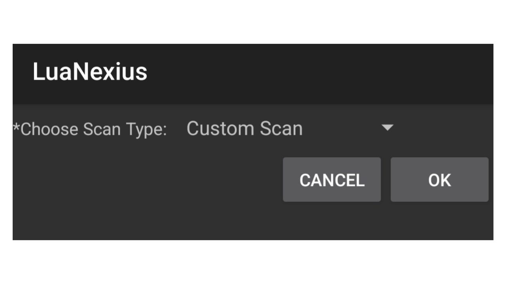

	

# 💻 Lua Nexius

> A lightweight IP lookup utility built with Lua and designed for the ExecLua environment. It uses the "ipapi.co" (https://ipapi.co/) API to retrieve public IP address information and display network-related details.

---

## 📌 Overview

	

---

Features

- ✅ Custom Scan
- ✅ Random Scan
- ✅ Scan My Network
- ✅ Detailed IP Information
- ✅ Interactive Forms
- ✅ Lightweight and Simple

---

## 🎯 Why This Repo?

these programs:

- Look up information for a user-provided IP address.
- Generate a random IPv4 address and query its available information.
- Retrieve information about your public IP address as seen by the API.
- Display information such as IP address, network, ISP/organization, ASN, city, region, country, coordinates, timezone, currency, and more.
- Use ExecLua's JSON form interface to select scan modes and enter IP addresses.
- Built with Lua and the "cjson" library for JSON encoding and decoding.

---

## 📌 Notes

- LuaNexius is intended for educational purposes and network information lookup.

- Random Scan performs a lookup on a generated IP address; it does not scan an entire network or verify that the address is active.

- Scan My Network retrieves public IP information and does not enumerate devices on your local network.

---

## ⚠️ Notice

LuaNexius only works by using ExecLua application.
[(Click here to download ExecLua)](https://play.google.com/store/apps/details?id=de.mlauer.luatest)

---

## 📥 Download
[Click here to download LuaNexius](https://github.com/xHak1m/LuaNexius/blob/main/main.lua)

---

## 📬 Contact

Feel free to connect or suggest improvements: https://github.com/xHak1m
